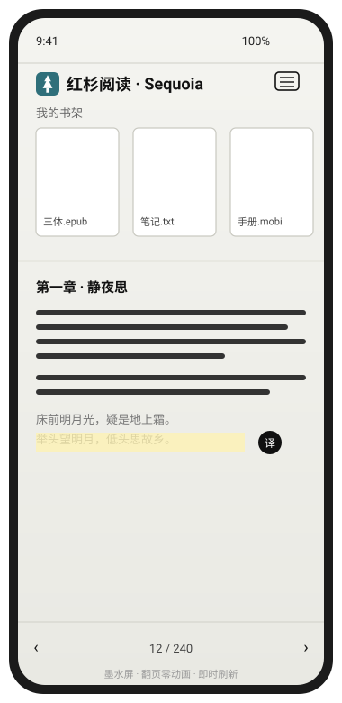

# 水杉 · Metasequoia

<p align="center">
  
</p>

## 📱 界面预览

| 书架（底部导航） | 阅读内页（墨水屏分页） |
|------|----------|
|  |  |
| 阅读统计（独立页面） | 设置 · 主题皮肤 |
|  |  |
| 分组书架（AI 类型） | 设置 · AI 引擎 / 打卡 |
|  |  |

<p align="center">
  <a href="https://github.com/rayyang-dev/ink-reader/releases"></a>
  
  
  
</p>

**水杉（Metasequoia）** 是一款面向「墨水屏阅读器 / 手机 / 平板」的本地优先电子书阅读应用。
它吸收了 KOReader、Moon+、Kindle、reMarkable、Neo Reader 的优点，解决传统方案的三大痛点：

- 排版与自定义差 → 提供克制的排版引擎与可调字体 / 边距 / 行距
- 翻页卡顿、残影严重 → **分页式阅读 + 翻页零动画 + 整屏反相刷新（Regal）**，贴合墨水屏特性
- 导入麻烦、广告多 → 纯本地、无广告、**App 内直接解析 MOBI**（无需 Calibre）

> 设计原则：**本地优先、零追踪，核心功能可离线使用**。书籍与进度只存在你自己的设备上。

---

## ✨ 特性

- 📚 **多格式导入**：EPUB / PDF / TXT / MOBI / FB2 / HTML / DOCX，App 内原生解析，MOBI 无需借助 Calibre（AZW3/KFX 仍建议用 Calibre 转 EPUB）
- 📖 **分页式阅读**：非滚动，按屏幕真实分页，接近纸质书体验
- ⚡ **墨水屏友好**：默认翻页零动画、按设置周期整屏刷新（Regal）规避残影；可在设置开启「翻书页动画」，手机端像翻书一样过渡
- 🎨 **3 款主题皮肤**：墨水风（宣纸底·笔迹淡化翻页）/ 简约（米白底·整页水平滑动）/ 夜览（低亮度暖灰），阅读内 `Aa` 面板一点即换
- 👁 **自动翻页系统**：定时 / 跟随你的翻页节奏 / **视线回扫**（读到页底、视线回到页首即翻页）。带校准、灵敏度、翻页前可取消预告、误翻一键撤销、状态灯与自动降级；摄像头帧严格端侧处理，默认关闭
- 🧭 **阅读内快捷设置**：常驻进度条（可拖动跳章）、字号/行距/主题/亮度即时调整、首次引导、滑动与音量键翻页、跳转后一键返回原位置
- 🧭 **底部导航 + 独立页面**：书架 / 统计 / 我的 / 设置 四页通过底部导航栏切换；**阅读统计与设置均为独立页面**（不再内嵌在阅读器里），设置页内置皮肤切换
- ✍️ **标注与收藏语句**：阅读时选中任意文字即可「标注」（正文持久高亮，翻页/重进自动还原）或「收藏」（只存句子不改正文）；点高亮可删除或顺手收藏，底部「我的」按书分组汇总，支持类型筛选、跳回原文、删除，设置页也有入口
- 🔤 **中英互译**：划词即译，可用 DeepSeek / 通义 / 本地 Ollama 等任意 OpenAI 兼容模型（详见下方「AI 引擎配置」），密钥仅存本地，默认关闭
- 🤖 **AI 助手（本地优先）**：同一套 Key/模型即可解锁「全书/本章导读、选中即问、书中问答、人物脉络笔记、智能书架标签、段落双语对照」；结果缓存到本机，默认关闭、按需联网
- 📱 **响应式 + PWA**：同一套界面适配手机 / 平板；可「添加到主屏幕」离线使用
- 💾 **本地存储**：书籍内容存 IndexedDB，设置 / 进度 / 书签 / 统计 / 标注 / 收藏存 localStorage（均带内存兜底）
- 📊 **阅读统计与打卡**：按日 / 周 / 月统计读了哪些书、各花多少时间；当日累计达「打卡阈值」（默认 10 分钟，可设置）自动打卡
- 🗂 **书架自动整理**：开启「书架按 AI 类型分组」后，书架空按 AI 标签归类，配合顶部标签筛选条快速找书
- 🤖 **Android 原生壳**：基于 Capacitor，包名 `com.rayyang.metasequoia`（应用名「水杉阅读」，英文名 **Metasequoia**）

---

## 🤖 AI 助手（本地优先）

水杉的 AI 不是另一个聊天机器人，而是**贴合阅读场景的伴读能力**。它在「阅读设置 → AI 引擎」里复用你自己的 Key 与模型（兼容任意 OpenAI 接口：OpenAI / DeepSeek / 通义 / 本地 Ollama），**密钥只存本机，本应用没有服务器**，默认完全关闭、仅在你需要时联网。

阅读页底部「AI」按钮打开 AI 助手面板，含四个标签页：

| 能力 | 说明 |
|------|------|
| **导读**（T1） | 一键生成「内容概要 + 阅读导读」，可生成全书或当前章节；结果缓存到本书，离线也能再看 |
| **问答**（T1） | 就本书提问，基于**轻量 RAG**（按关键词检索最相关段落再作答），只引用书中内容 |
| **笔记**（T2） | 抽取人物/实体关系、关键脉络时间线、核心要点，生成结构化阅读笔记 |
| **双语**（T2） | 把当前页拆成段落，逐段中英对照（依赖翻译方向设置） |

此外：

- **选中即问**：阅读时选中任意文字，浮出「译 / AI 解释 / 标注 / 收藏」工具条——「AI 解释」会结合全书上下文解释术语、典故或难句。
- **智能书架**：在书架可一键「AI 归类」，自动给书打主题/题材/难度/情绪标签；书架顶部出现标签筛选条，按标签快速找书。
- **自动导读**（可选开关）：导入新书且已配置 AI 时，后台静默生成导读并缓存，打开即看。

> 隐私与设计原则：**本地优先、零追踪**。AI 功能默认关闭；启用后也只有当你主动触发（生成/提问/解释/翻译）才会向你所填的接口地址发请求，书籍与结果始终只存你自己的设备。

---

## 👁 自动翻页与视线回扫（Pro）

把「自动翻页」做成一个**可预期、可取消、可撤销、可暂停、可降级**的闭环，而不是一个孤立的 AI 开关：

| 方式 | 触发 | 适用 |
|------|------|------|
| 定时 | 固定间隔（4–60 秒） | 解放双手、稳定可靠，所有设备可用 |
| 跟随节奏 | 学习你最近几次手动翻页的间隔 | 阅读速度不均匀时更贴合 |
| 视线回扫 | 视线在页底驻留 → 快速回到页首（return sweep） | 接近纸质书的自然翻页动作 |

**为什么比「盯到底部就翻页」可靠**：低头沉思、看插图、走神都会让视线停在低处，单条件判定必然误翻。两阶段的「页底驻留 + 回扫」判据，配合连续帧确认、冷却时间、灵敏度调节与个人校准，把误触发挡在门外。

**做得更全的地方**：
- **可预期**：顶部状态灯实时说明「追踪中 / 已读到页底 / 准备翻页 / 已暂停 / 不支持」；翻页前弹出倒计时预告。
- **可取消**：预告窗口内点一下屏幕即取消本次翻页；面板打开、划词选字、切后台时自动暂停。
- **可撤销**：任何来源的自动翻页都能一键回到刚才那一页（手动翻页同样可撤销）。
- **可校准**：先看页顶、再看页底各 1.5 秒，记录个人视线量程；灵敏度 1–5 档可调。
- **可降级**：设备不支持、无摄像头或拒绝授权时，明确提示并自动切换为「定时」，绝不留下一个开了没反应的开关。
- **隐私与耗电**：视频帧只在内存中降采样推理，**不上传、不保存、不写日志**；默认关闭，退出阅读器 / 切后台立即释放摄像头；约 11fps 取帧，不做逐帧 60fps 推理。

**检测引擎是可插拔的**（`js/gaze.js`）：优先使用系统 `FaceDetector`（零额外体积）；把 MediaPipe `vision_bundle.mjs` + wasm + `face_landmarker.task` 放入 `www/js/vendor/mediapipe/` 即自动升级为虹膜级检测；无摄像头环境使用模拟源，便于自动化回归。之所以不把这些文件随包分发：wasm + 模型约 18MB，会让 3.8MB 的应用膨胀数倍，且在未经真机验证前不适合进正式包。需要虹膜级精度的用户可自行放置本地模型文件，应用会自动探测启用。

> 视线翻页需要 Android 端 `CAMERA` 权限（默认不申请，仅在主动开启时请求）；PWA / 浏览器同样可用（浏览器自行弹权限）。纯血鸿蒙 NEXT 的 ArkWeb 若不支持 `getUserMedia`，会自动走降级路径。

---

## 📊 阅读统计 · 打卡 · 自动整理书架

水杉把「读得多认真」也留在本地（同样只存本机、不联网）：

- **阅读统计**：底部导航的「统计」进入独立统计页，按 **日 / 周 / 月** 切换，展示总时长、阅读书目数、打卡状态，以及每本书的阅读分钟数明细。
- **自动打卡**：在阅读页停留即累计时长；**切到后台或打开任意面板时自动暂停**，避免虚高。当日累计达到「打卡阈值」即自动打卡并弹出轻提示。打卡阈值默认 10 分钟，可在 **设置 → 阅读与书架** 调整（1–60 分钟）。
- **书架自动整理**：在 **设置 → 阅读与书架** 开启「书架按 AI 类型分组」后，书架空按每本书的 AI 标签归类，未分类的归入「未分类」；书架顶部的标签筛选条可一键按标签过滤。

> 计时与打卡数据仅存于本机 localStorage，不上传、不联网。AI 归类（标签来源）默认关闭、按需使用，不影响离线阅读。

---

## 📸 功能一览（截图 + 说明）

### 📚 多格式导入与书架

本地优先的书架：支持 EPUB / PDF / TXT / MOBI / FB2 / HTML / DOCX 一键导入（MOBI 在 App 内原生解析，无需 Calibre；AZW3/KFX 仍建议用 Calibre 转 EPUB），顶部按 AI 标签快速筛选；底部导航栏在书架 / 统计 / 设置 间切换；空书架有友好引导。

### 📖 分页式阅读（墨水屏优化）

按屏幕真实尺寸分页（非滚动）。**默认翻页零动画、整屏反相刷新（Regal）** 规避残影；可在 **设置 → 屏幕与翻页** 开启「翻页动画」，前后翻页以翻书页的方式 3D 过渡。可调字体 / 边距 / 行距 / 段距 / 字间距、两端对齐与首行缩进。

### 🎨 主题皮肤 + 底部导航 + 独立页面

底部导航的「设置」是**独立页面**，内置 **2 款一键切换的皮肤**：墨水风（宣纸底·笔迹淡化翻页）/ 简约（米白底·整页水平滑动）。所有设置只存本机。

### 📊 阅读统计与自动打卡

底部导航的「统计」进入**独立统计页**，按 **日 / 周 / 月** 汇总：总时长、阅读书目数、打卡状态，以及每本书的阅读分钟数明细。在阅读页停留即累计时长，切后台或打开面板自动暂停；当日累计达「打卡阈值」（默认 10 分钟）自动打卡。

### 🗂 书架按 AI 类型自动分组

在 **设置 → 阅读与书架** 开启「书架按 AI 类型分组」后，书架空按每本书的 AI 标签归类（未分类归入「未分类」），配合顶部标签筛选条快速找书。

### 🤖 AI 助手（本地优先）

阅读页「AI」按钮打开面板：全书/本章导读、书中问答（轻量 RAG，只引用书中内容）、人物脉络笔记、段落双语对照；结果缓存到本机，默认关闭、按需联网。

### 🔤 中英互译（DeepSeek 等通用模型）

划词即译，可用 DeepSeek / 通义 / 本地 Ollama 等任意 OpenAI 兼容模型（详见下方「AI 引擎配置」）。选中文字还可用「AI 解释」结合全书上下文讲解术语或难句，或用「标注 / 收藏」把句子记进「我的」。在 **设置 → AI 引擎** 选「AI 大模型」并填 Key 即可（例如 DeepSeek：Base `https://api.deepseek.com/v1`、Model `deepseek-chat`）。

### 📭 空书架引导

首次打开或暂无书籍时的引导页，提示从本地导入电子书（支持 EPUB / PDF / TXT / MOBI / FB2 / HTML / DOCX）。

## 📦 安装

### Android APK（推荐）

前往 **[Releases](https://github.com/rayyang-dev/ink-reader/releases)** 下载 `Metasequoia-release.apk`（已签名发布版，推荐）或 `Metasequoia-debug.apk`（调试版），
在手机上允许「未知来源」安装即可。无需登录、无后台联网。

> 鸿蒙 NEXT（纯血）已移除 AOSP，**安卓 APK 无法原生安装**；若通过兼容容器（如卓易通）运行，文件选择器可用性取决于容器实现（已做兼容性加固，见下方「鸿蒙 NEXT」）。更稳妥的方式是安装下面的原生 .hap。

### 鸿蒙 NEXT（原生 .hap）

为 HarmonyOS NEXT 提供**原生 ArkWeb** 构建，书籍存储与导入均按系统 WebView 正常能力工作，不依赖兼容容器：
1. 安装 **DevEco Studio**（含 HarmonyOS SDK）并用华为开发者账号签名；
2. `npm install && npx cap sync harmony` 把 `www/` 同步进 `harmony/.../rawfile/www`；
3. DevEco 内 `Build → Build HAP (debug)`，或命令行 `cd harmony && hvigorw assembleHap --mode module -p product=default -p buildMode=debug --no-daemon`；
4. `hdc install` 或用 DevEco 直连真机运行。详见仓库 `harmony/` 工程与 `docs/华为上架清单.md`。

### Web / PWA

直接用浏览器打开托管地址，或本地启动静态服务：

```bash
# 在本仓库 www/ 目录下起一个静态服务器即可
npx serve www
```

在手机浏览器中「添加到主屏幕」，即可获得类原生体验。

---

## 🛠 从源码构建（Android）

环境要求：**JDK 21+**（Capacitor 8 原生模块需 Java 21 编译）、**Android SDK（platform 36 + build-tools 36.0.0）**、Node 22+。

```bash
# 1. 安装依赖
npm install

# 2. 同步 Web 资源到原生工程
npx cap sync android

# 3. 构建 Debug 包
cd android
./gradlew assembleDebug
# 产物：android/app/build/outputs/apk/debug/Metasequoia-debug.apk

# 4. 构建签名 Release 包（需自行提供 keystore，见下）
./gradlew assembleRelease
# 产物：android/app/build/outputs/apk/release/Metasequoia-release.apk
```

> 若 `JAVA_HOME` 指向了旧 JDK，请先修正，例如：
> `export JAVA_HOME="C:/Android/jdk-21.0.13+9"`
> 安装 SDK 平台：`sdkmanager "platforms;android-36" "build-tools;36.0.0" "platform-tools"`

### Release 签名

Release 包需要签名。本项目在 `android/app/build.gradle` 中读取 `android/local.properties` 的签名配置（该文件已被 `.gitignore` 忽略，不会进仓库）。在 `local.properties` 末尾追加：

```properties
keystore.path=C:/path/to/your-release-key.jks
keystore.alias=inkreader
keystore.password=你的密钥库密码
keystore.keyPassword=你的密钥密码
```

没有 keystore？用 JDK 的 `keytool` 生成（妥善保管，丢失将无法更新同一签名的包）：

```bash
keytool -genkeypair -v -keystore release-key.jks -alias inkreader \
  -keyalg RSA -keysize 2048 -validity 10000
```

---

## 🌐 AI 引擎配置（翻译 / 摘要 / 问答 / 标签 / 笔记 共用）

默认关闭，且不影响离线阅读。在阅读页**选中一段文字**会浮出「译 / AI 解释 / 标注 / 收藏」工具条；点「AI」按钮可打开 AI 助手面板。

设置项（存于 localStorage，不上传）：

| 配置 | 说明 |
|------|------|
| AI 引擎 | none / mock / DeepL / Google / LLM（AI 大模型） |
| API Key | 仅本地保存，默认空 |
| LLM Base | 兼容 OpenAI 的 `/v1` 地址，默认 `https://api.openai.com/v1` |
| LLM Model | 如 `gpt-4o-mini` |
| 方向 | 自动 / 中→英 / 英→中 |
| 导入后自动生成导读 | 开关，开启后导入新书自动后台生成导读 |

`mock` 后端离线返回占位译文，可用于体验流程；真实翻译与 AI 能力请填入对应后端 Key（选「AI 大模型」即同时解锁摘要/问答/笔记/标签/双语）。

> **中英翻译可用 DeepSeek 等通用大模型**：只要填「AI 大模型」并把 **LLM Base** 设为 OpenAI 兼容地址、**LLM Model** 设为对应模型名、**API Key** 填该平台的 Key 即可。例如用 DeepSeek：Base `https://api.deepseek.com/v1`、Model `deepseek-chat`、Key 填 DeepSeek 控制台获取的 Key——翻译、导读、书中问答、人物笔记、智能标签、段落双语全部走这一个模型，无需单独对接翻译 API。同样可换通义 / 智谱 / 本地 Ollama 等任意 OpenAI 兼容服务。

---

## 🧱 技术栈

- 前端：原生 ES Modules（无打包构建）、IndexedDB、Service Worker（PWA）
- 解析：[fflate](https://github.com/101arrowz/fflate)（EPUB / DOCX）、[pdf.js v4](https://github.com/mozilla/pdf.js)（PDF）、自研 MOBI 解析器、原生 DOMParser（FB2 / HTML）
- 原生壳：Capacitor 8（Android / HarmonyOS NEXT；`android/` 为安卓工程，`harmony/` 为鸿蒙原生 .hap 工程）
- 测试：`puppeteer-core` + 系统 Chrome 的真实浏览器端到端（`npm test`，含 Pro 层 / 冒烟 / 跨文件脚注 / 标注收藏四套回归），另附 `test/regen-screenshots.mjs` 生成界面截图

---

## 📁 项目结构

```
metasequoia-reader/
├── www/                            # Web 应用（PWA 入口，也是 Capacitor 的 webDir）
│   ├── index.html                  # 单页结构：书架 / 阅读器 / 统计页 / 我的页 / 设置页 / 底部导航栏（阅读器内仍保留目录/书签/AI 侧滑面板）
│   ├── css/style.css               # 墨水屏主题与全部样式（3 款皮肤 / 翻书页 3D 动画 / Regal 整屏反色 / 纸感设计令牌）
│   ├── css/pro.css                 # Pro 层独立样式：进度条 / 状态灯 / 预告 / 撤销 / 快捷面板 / 夜览（可整体删除回退）
│   ├── books/sample.js             # 内置示例书《阅读者手记》（无版权风险，用于演示）
│   └── js/
│       ├── app.js                  # 主控：书架渲染 / 分页翻页（含翻书页动画）/ 底部导航与独立页面切换 / 阅读计时打卡 / 面板与设置接线
│       ├── store.js                # 存储层：IndexedDB 存书籍 + localStorage 存设置/进度/书签/统计/标注/收藏（均带内存兜底）
│       ├── paginate.js             # 按屏幕真实尺寸的分页引擎（非滚动）
│       ├── translate.js            # 中英互译（mock / DeepL / Google / 通用 LLM 可插拔）
│       ├── llm.js                  # OpenAI 兼容统一客户端（翻译 / 摘要 / 问答 / 笔记 共用）
│       ├── ai.js                   # AI 能力：导读 / 选中即问解释 / 书中问答(RAG) / 人物脉络笔记 / 智能标签 / 段落双语
│       ├── importers.js            # EPUB / TXT / PDF / MOBI / FB2 / HTML / DOCX 导入解析入口
│       ├── mobidec.js              # 自研 MOBI 解析器（App 内直接解析，无需 Calibre）
│       ├── pdfview.js              # pdf.js 整页渲染（扫描型 PDF 整页显示）
│       ├── turn.js                 # 统一翻页编排层：串行化 / 冷却 / 预告取消 / 撤销 / 自动翻页节奏
│       ├── gaze.js                 # 视线回扫信号源：可插拔检测引擎 / 校准 / 状态机 / 隐私护栏 / 降级
│       └── pro.js                  # 阅读器交互增强：进度条 / Aa 快捷面板 / 首次引导 / 滑动与音量键 / 返回原位置
├── android/                        # Capacitor 生成的 Android 原生工程（包名 com.rayyang.metasequoia）
├── harmony/                        # Capacitor 鸿蒙（HarmonyOS NEXT）原生工程，产出 .hap（rawfile/www 由 cap sync 生成，未进仓库）
├── docs/                           # 界面示意图 mockup.svg + 真实截图 screenshots/
├── test/                           # puppeteer-core 真实浏览器回归（smoke / footnote / marks）+ 截图重生成脚本
├── capacitor.config.json           # Capacitor 配置（appId / appName / webDir）
└── README.md
```

> 架构要点：前端是**零构建的原生 ES Modules**（无 webpack/vite），直接在浏览器与 Capacitor WebView 中运行；所有第三方能力（EPUB/PDF/MOBI 解析、LLM 调用）都收敛在 `js/` 下、以纯函数 + 可控的 `fetch` 实现，便于在 Node 环境下做单元测试。存储与联网均遵循「本地优先、零追踪」：书籍在 IndexedDB、设置/进度/书签/统计/标注/收藏在 localStorage，AI 仅在用户主动触发且已填 Key 时才向用户指定的接口发请求。

---

## ✅ 测试

```bash
npm test                        # 打包闸门：Pro 层 + 冒烟 + 跨文件脚注 + 标注收藏，四套真实浏览器回归
npm run test:pro                # 翻页编排层与视线回扫状态机（模拟视线，无需真机摄像头）15 用例
npm run test:smoke              # 书架按钮 / EPUB 导入 / 图片内联 / 分页 / 控制条（样本书自动合成）
npm run test:footnote           # 内存合成 EPUB：同文件/跨文件/图片式脚注、旧书兼容（6 用例）
npm run test:marks              # 标注高亮持久化、收藏、我的页汇总/筛选/跳转/删除（11 用例）
node test/regen-screenshots.mjs # 真实浏览器全页面截图，输出至 docs/screenshots/
```

四套回归都用 `puppeteer-core` + 系统 Chrome 加载真实 `www/`，通过 DOM 事件与 IndexedDB/localStorage 断言端到端行为；`footnote.mjs` 与 `marks.mjs` 会在内存中用 fflate 合成 EPUB，不依赖本机书籍。`test/regen-screenshots.mjs` 对空书架 / 平铺书架 / 分组书架 / 阅读器 / 独立设置页 / 独立统计页 / AI 面板各截一张图。

---

## 📜 许可证

[MIT](LICENSE) —— 自由使用、修改与分发。
